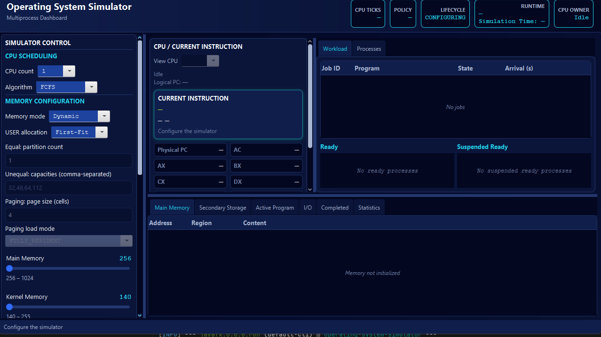
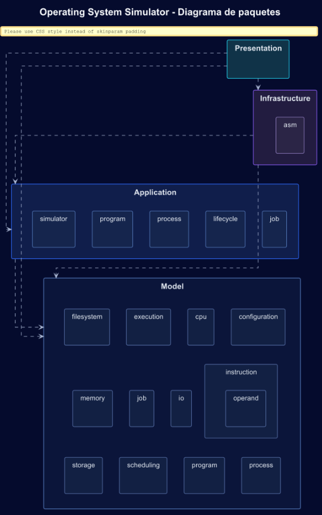

<div align="center">

# 🖥️ Operating System Simulator

### Simulador educativo Multi-CPU de planificación de procesos y administración de memoria

Aplicación de escritorio desarrollada en **Java 25 + JavaFX** para explorar visualmente
**CPU Scheduling**, procesos, PCB, **Memory Management**, **Virtual Memory**,
**Context Switching**, interrupciones, I/O y estadísticas de una minicomputadora simulada.

<br>


<br>

</div>

---

<div align="center">



</div>

---

## 📋 Contenido

- [🎓 Información académica](#-información-académica)
- [🚀 Descripción del proyecto](#-descripción-del-proyecto)
- [✨ Características principales](#-características-principales)
- [📐 Diagrama de Paquetes](#-diagrama-de-paquetes)
- [🏗️ Arquitectura](#️-arquitectura)
- [🧠 Modelo del sistema operativo](#-modelo-del-sistema-operativo)
- [⚙️ Instruction Set](#️-instruction-set)
- [📊 Statistics](#-statistics)
- [🛡️ Protection & Security](#️-protection--security)
- [🎨 Principios de diseño](#-principios-de-diseño)
- [🛠️ Tecnologías](#️-tecnologías)
- [📦 Requisitos](#-requisitos)
- [💻 Instalación y ejecución](#-instalación-y-ejecución)
- [🖥️ Uso general](#️-uso-general)
- [🧪 Testing y validación](#-testing-y-validación)
- [🌿 GitFlow y DevOps](#-gitflow-y-devops)
- [✅ Objetivos alcanzados](#-objetivos-alcanzados)
- [ℹ️ Decisiones y consideraciones](#️-decisiones-y-consideraciones)
- [🎥 Video demostrativo](#-video-demostrativo)

---

# 🎓 Información académica

| Información | Detalle |
|---|---|
| **Institución** | Tecnológico de Costa Rica |
| **Curso** | Principios de Sistemas Operativos |
| **Proyecto I** | Gestor de Multiprocesos — base funcional y arquitectura |
| **Proyecto II** | Multi-CPU, CPU Scheduling, Memory Management y Statistics |
| **Estudiante** | Raúl Alfaro Rodríguez — 2023060456 |
| **Estudiante** | Diego Araya Ureña — 2023071310 |
| **Estado** | Proyecto II Implementado |

> [!NOTE]
> Este es un **simulador académico**: no implementa un Kernel real ni administra el hardware o
> los procesos del equipo anfitrión. Se conserva la información académica del README original.

---

# 🚀 Descripción del proyecto

**Operating System Simulator** permite cargar múltiples programas en un mini lenguaje
ensamblador `.asm`, configurar sus tiempos de llegada y observar cómo un Sistema Operativo
simulado los admite, planifica, ejecuta y libera sus recursos.

```text
Archivo(s) .asm
       ↓
   ASM Parser
       ↓
  Program Image → Secondary Storage
       ↓
     Job List ← Arrival Time editable después de Load
       ↓
Admission / CPU Affinity
       ↓
  Process + PCB (Kernel)
       ↓
Ready Queues por CPU
       ↓
Scheduling Policy seleccionada
       ↓
    Dispatcher
       ↓
 CPU 1 ... CPU N  (N = 1..5)
       ↓
 Execution Engine
       ↓
Memory / Paging / I/O / Statistics
```

La GUI permite inspeccionar **CPU Status, Current Instruction, Workload, Process/PCB,
Memory View, Secondary Storage, Scheduling Timeline/Gantt y Statistics** mediante vistas
y snapshots del estado simulado.

---

# ✨ Características principales

### 🧩 Multiprocess & Multi-CPU Runtime

- **1–5 CPU** configurables, con **5 procesos admitidos por CPU** (hasta 25 en total).
- Job List, Process Table, Ready Queues locales y **Fixed CPU Affinity**.
- Workload con **Arrival Time** y admisión basada en el reloj lógico.
- **10 Scheduling Algorithms**, incluyendo políticas preemptive y non-preemptive.
- Dispatcher, **Context Switching**, guardado y restauración de `CpuContext`.
- Simulación **Step / Automatic / Pause / Resume / Reset**.
- `SimulationClock` global y coordinación determinista de cada **Global Step**.
- Preemption transaccional: consistencia de CPU owner, PCB, Kernel y ReadyQueue.

### 🧠 PCB / BCP

Cada proceso conserva, entre otros datos:

```text
PID / Process State / CPU Affinity
Logical PC / Physical PC / IR
AC / AX / BX / CX / DX / Flags
Stack / Open Files / Priority
Base / Limit / Accounting
Kernel PCB Address / Context
```

El PCB canónico se sincroniza con su representación de **28 celdas en Kernel Memory**.
El **Logical PC inicia en 4096**; la dirección física se deriva del mecanismo de memoria
configurado. La suspensión o relocalización no cambia la identidad del proceso.

### 💾 Main Memory

```text
┌────────────────────────────┐
│       KERNEL MEMORY        │
├────────────────────────────┤
│        USER MEMORY         │
└────────────────────────────┘
```

- Memoria principal y región Kernel configurables; **default: Main 256 / Kernel 140**.
- Separación y protección entre Kernel/User, validación de rangos y handles canónicos.
- **Dynamic Allocation:** First Fit, Next Fit y Best Fit.
- **Fixed Partitioning:** particiones Equal y Unequal.
- **Paging:** Page Tables, Frames y traducción de direcciones lógicas a físicas.
- Liberación y reutilización de memoria, con visualización de ocupación y estado.

### 💿 Secondary Storage

```text
┌────────────────────────────┐
│         FILE_INDEX         │
├────────────────────────────┤
│        PROGRAM_DATA        │
├────────────────────────────┤
│       VIRTUAL_MEMORY       │
└────────────────────────────┘
```

```text
Secondary Storage : 512 (default)
Virtual Memory    :  64 (default)
```

Almacena las imágenes ASM, recursos del filesystem simulado y datos de respaldo
necesarios para los mecanismos de residencia y Virtual Memory.

### 🔄 Virtual Memory, Demand Paging & CLOCK

- **Fully Resident Paging:** las páginas necesarias están residentes antes de ejecutar.
- **Demand Paging:** carga de páginas bajo demanda, Page Faults y solicitudes pendientes.
- **CLOCK / Second-Chance:** selección de Frames para reemplazo y recuperación.
- **Backing Store**, Page Tables y sincronización de residencia/estado del proceso.
- Mecanismos de **swapping** y estados suspendidos del modelo original.
- Page Fault, Page-In y Context Switching no añaden por sí solos ticks de instrucción.

### ⏱️ CPU Scheduling

| Algorithm | Modalidad o criterio principal |
|---|---|
| **FCFS** | First Come, First Served |
| **SPN** | Shortest Process Next |
| **SRT** | Shortest Remaining Time |
| **RR** | Round Robin, Quantum configurable |
| **HRRN** | Highest Response Ratio Next |
| **Priority** | Prioridades y Aging |
| **Lottery** | Tickets y selección pseudoaleatoria controlada |
| **Guaranteed** | Fairness según servicio recibido |
| **Selfish RR** | Prioridades dinámicas NEW / ACCEPTED |
| **MLFQ** | Multilevel Feedback Queue configurable |

**MLFQ** admite **2–5 niveles**, Quantum de **1–10 instrucciones por nivel** y default
`[1,2,4]`. Cada CPU dispone de una instancia local de su Scheduling Policy; la
configuración compartida es inmutable.

### 🖥️ JavaFX Dashboard & Visualización

- Configuración de CPU, Scheduling Policy y parámetros, memoria y modalidad de asignación.
- **Browse / Load Programs** múltiple, Workload y Arrival editable para Jobs `PENDING`
  mientras la sesión permanece en `PROGRAM_LOADED`.
- Paneles de CPU, registros, procesos, PCB, memoria y Secondary Storage.
- **Gantt/Timeline** de ejecución por CPU y panel de estadísticas por sesión.
- Vistas derivadas de snapshots, separadas de la lógica de Model/Application.

### 🖥️ Simulated Screen

`INT 10H` envía a la pantalla simulada el valor numérico de `DX`.

### 📁 Simulated Filesystem

`INT 21H` conserva los servicios del filesystem educativo:

| Service | Operación |
|---|---|
| `3CH` | Create |
| `3DH` | Open |
| `4DH` | Read |
| `40H` | Write |
| `41H` | Delete |

> [!IMPORTANT]
> Las system calls trabajan sobre recursos **simulados**. No modifican archivos reales
> del equipo anfitrión. **`INT 09H` y el antiguo simulated keyboard fueron retirados**
> del proyecto; el ASM Parser ya no acepta esa interrupción.

---

# 📐 Diagrama de Paquetes

El **Package Diagram** conserva la organización general por capas y sus dependencias
principales. Es una referencia visual de la estructura del proyecto; los componentes
agregados para Scheduling, Paging y Statistics se describen en las secciones siguientes.

<div align="center">



</div>

---

# 🏗️ Arquitectura

**Layered Architecture** con principios `MVC` en Presentation:

```text
┌─────────────────────────────────────────┐
│              PRESENTATION               │
│       JavaFX · FXML · CSS · MVC         │
└───────────────────┬─────────────────────┘
                    │
                    ▼
┌─────────────────────────────────────────┐
│              APPLICATION                │
│ Orchestration · Admission · Runtime     │
│ CPU Topology · Dispatcher · Statistics  │
└───────────────────┬─────────────────────┘
                    │
                    ▼
┌─────────────────────────────────────────┐
│                 MODEL                   │
│ PCB · Processes · Scheduling · Memory   │
│ Paging · CPU · Instructions · Storage   │
└─────────────────────────────────────────┘
                    ▲
                    │
┌─────────────────────────────────────────┐
│            INFRASTRUCTURE               │
│         ASM Import / Adapters           │
└─────────────────────────────────────────┘
```

### Presentation

JavaFX Controllers, FXML/CSS, interacción del usuario y rendering de snapshots.
No ejecuta directamente Scheduling ni administra estructuras internas del Model.

### Application

`SimulatorOrchestrator`, lifecycle, program submission, Admission,
`MultiprocessRuntime`, CPU Topology, Dispatcher y consolidación de estadísticas.

### Model

CPU, registers, instructions, procesos, PCB, Scheduling Policies, configuración,
Memory Allocation, Paging, Virtual Memory, storage y filesystem simulado.

### Infrastructure

Lectura, importación y parsing de programas `.asm`, mediante adapters separados del dominio.

---

# 🧠 Modelo del sistema operativo

## Process States

```text
NEW → READY → RUNNING → TERMINATED
         ↑        │
         └────────┘  Preemption / Quantum

BLOCKED / READY_SUSPENDED / BLOCKED_SUSPENDED
```

Los procesos pueden esperar por **capacidad, memoria, páginas o eventos simulados**.
El estado de un Job (`PENDING`, `ADMITTED`, etc.) no equivale necesariamente al
estado de ejecución de su proceso.

## Scheduling

El Scheduler se selecciona antes de `Initialize` y se instancia por CPU. Las políticas
conservan sus reglas específicas de selección, desempate, Quantum, Aging y Preemption.

```text
           Global SimulationClock
                     │
          Multi-CPU Scheduling Point
              ┌──────┴──────┐
              ▼             ▼
          CPU 1 Queue   CPU N Queue
              │             │
        Local Policy   Local Policy
              └──────┬──────┘
                     ▼
             Global Step Commit
```

Los arreglos de colas son locales a cada CPU. El Runtime conserva la **Fixed CPU
Affinity** y la semántica transaccional cuando ocurre una Preemption fallida.

## Context Switching

```text
Physical CPU ── save ──→ PCB CpuContext
Physical CPU ← restore ── PCB CpuContext
```

Se preservan registros, flags, Logical PC y contexto del proceso. El PCB físico
se sincroniza con Kernel Memory y no se publica una expulsión incompleta.

## CPU Tick Model

```text
1 Global Step = 1 segundo lógico
1 CPU activa  = máximo 1 instrucción completada por Step
1 instrucción = 1 CPU tick
Automatic     = aproximadamente 1 Step / segundo real
```

Cada CPU puede ejecutar una instrucción en el mismo Global Step; el tiempo global
avanza **una sola vez**. Las transiciones administrativas (admisión, dispatch,
context switch, Page Fault y CLOCK) no tienen un coste de ticks adicional por sí mismas.

---

# ⚙️ Instruction Set

Mini lenguaje `.asm` con registers, operaciones aritméticas, control de flujo,
stack e interrupciones. **Todas las instrucciones ejecutables consumen 1 tick**, sin
pesos diferenciados por opcode.

| Instruction | Descripción | Ticks |
|---|---|---:|
| `MOV R1, R2` | Transferencia entre registers | 1 |
| `MOV R, N` | Immediate hacia register | 1 |
| `LOAD R` | `AC ← R` | 1 |
| `STORE R` | `R ← AC` | 1 |
| `ADD R` | `AC ← AC + R` | 1 |
| `SUB R` | `AC ← AC - R` | 1 |
| `INC` / `INC R` | Incremento | 1 |
| `DEC` / `DEC R` | Decremento | 1 |
| `SWAP R1, R2` | Intercambio entre registers | 1 |
| `CMP R1, R2` | Comparación | 1 |
| `JMP displacement` | Salto relativo | 1 |
| `JE displacement` | Salto condicionado a Equal | 1 |
| `JNE displacement` | Salto condicionado a Not Equal | 1 |
| `PARAM v1, ...` | Parámetros del stack | 1 |
| `PUSH R` | Push al stack | 1 |
| `POP R` | Pop desde stack | 1 |
| `INT 10H` | Simulated Screen | 1 |
| `INT 20H` | Process Termination | 1 |
| `INT 21H` | Simulated Filesystem Services | 1 |

> [!NOTE]
> `INT 09H`, el teclado simulado y el antiguo Binary Decoder no forman parte del
> alcance vigente. Los saltos trabajan sobre Logical PC y su traducción física.

---

# 📊 Statistics

El dashboard presenta métricas de ejecución lógica, por CPU y por proceso,
además de resultados acumulados de sesiones completadas.

| Métrica | Definición |
|---|---|
| **Arrival** | Tiempo lógico de llegada configurado para el Job |
| **Start / First Dispatch** | Primer instante de ejecución asignada |
| **Finish** | Instante de finalización |
| **Turnaround** | `Finish - Arrival` |
| **Response** | `First Dispatch - Arrival` |
| **Waiting** | `Turnaround - CPU Service` |
| **Tr/Ts** | `Turnaround / Declared Burst` |
| **CPU Busy / Idle** | Ticks de actividad e inactividad por CPU |
| **Utilization** | Proporción de tiempo lógico con CPU ocupada |

```text
Logical Time (SimulationClock)
             ≠
Wall-Clock Time (Instant / Duration)
```

`Pause`, la interacción manual o el tiempo real del anfitrión no añaden ticks de CPU.
Las métricas lógicas se basan en los eventos confirmados del Runtime. El historial
de estadísticas puede mantenerse entre ejecuciones reiniciadas, según el contrato
de la sesión.

---

# 🛡️ Protection & Security

La protección se aplica a los **recursos simulados**:

- aislamiento Kernel/User y validación de límites de memoria;
- handles de Allocation y protección frente a referencias obsoletas;
- validación y sincronización del PCB físico de 28 celdas;
- Process Isolation, CPU Affinity y lifecycle guards;
- rollback de Preemption ante fallos recuperables;
- validación de Page Tables, Frames y Backing Store;
- separación de regiones de Secondary Storage y filesystem simulado.

---

# 🎨 Principios de diseño

- Object-Oriented Programming y Separation of Concerns.
- High Cohesion, Low Coupling y Encapsulation.
- Defensive Programming y type safety.
- SOLID pragmático y Dependency Injection manual.
- Immutable domain configuration y snapshots.
- Scheduling Policies independientes mediante Factory/Strategy.
- Deterministic testing, prevalidación y transiciones con rollback local.
- Presentation desacoplada del Runtime y del Model.

---

# 🛠️ Tecnologías

| Tecnología | Uso |
|---|---|
| **Java 25** | Lenguaje principal y lógica del simulador |
| **JavaFX 25** | Desktop GUI |
| **FXML / JavaFX CSS** | Layout y diseño visual |
| **Maven / Maven Wrapper** | Build, dependencias y ejecución reproducible |
| **JUnit 5** | Automated Unit y Integration Tests |
| **PlantUML** | Package Diagram y diagramas UML |
| **Git / GitHub** | Version control, Issues y Pull Requests |
| **GitHub Actions** | Continuous Integration |

---

# 📦 Requisitos

- **Git**.
- **Eclipse Temurin OpenJDK 25** o distribución compatible.
- Windows, Linux o macOS con entorno gráfico compatible con JavaFX.
- Maven global **no es necesario**: se utiliza Maven Wrapper.

Verificar Java:

```powershell
java --version
```

---

# 💻 Instalación y ejecución

## 1. Clonar el repositorio

```powershell
git clone https://github.com/RaJami1205/Operating_System_Simulator.git
cd Operating_System_Simulator
```

## 2. Ejecutar tests

Windows:

```powershell
.\mvnw.cmd test
```

Linux / macOS:

```bash
./mvnw test
```

## 3. Validación completa

Windows:

```powershell
.\mvnw.cmd --batch-mode --no-transfer-progress verify
```

Linux / macOS:

```bash
./mvnw --batch-mode --no-transfer-progress verify
```

## 4. Ejecutar la aplicación

Windows:

```powershell
.\mvnw.cmd javafx:run
```

Linux / macOS:

```bash
./mvnw javafx:run
```

---

# 🖥️ Uso general

Flujo típico del Proyecto II:

```text
 1. Configurar CPU count (1..5) y Memory / Storage
 2. Elegir Memory Allocation Mode y Paging (si aplica)
 3. Seleccionar Scheduling Algorithm y sus parámetros
 4. Initialize
 5. Browse y seleccionar uno o varios archivos .asm
 6. Load Programs (Job List en estado PENDING)
 7. Editar Arrival (s) en Workload antes de Start
 8. Start y ejecutar con Step o Automatic
 9. Pause / Resume, cuando corresponda
10. Observar CPU, Ready Queues, PCB, Paging y Timeline
11. Revisar Completed Processes y Statistics
12. Reset para configurar otra sesión
```

Ejemplo básico de programa `.asm`:

```asm
MOV AX, 10
MOV BX, 5
LOAD AX
ADD BX
MOV DX, 25
INT 10H
INT 20H
```

> [!TIP]
> La edición de Arrival después de Load solo está permitida cuando la sesión se
> encuentra en `PROGRAM_LOADED` y el Job sigue `PENDING`. Una vez admitido o
> iniciada la ejecución, ese tiempo deja de ser editable.

---

# 🧪 Testing y validación

Validaciones automatizadas **reportadas** en el desarrollo del Proyecto II:

| Referencia | Tests | Resultado |
|---|---:|---|
| **Última baseline integrada en `dev` confirmada (A03)** | **1279** | BUILD SUCCESS · 0 failures/errors/skipped |
| **Implementación A04 en `fix/a04-scheduling-numeric-safety`** | **1289** | BUILD SUCCESS · 0 failures/errors/skipped |

> [!NOTE]
> A04 superó su implementación y Final Diff Audit, pero **su merge hacia `dev` no está
> confirmado en este registro**. Por ello, el total de 1289 no se presenta como
> baseline integrada de `dev` hasta verificar ese merge y su CI.

La cobertura abarca:

- CPU, registers, ASM Parser, Instruction Set y PCB/Context Switching;
- Multi-CPU, Workload Arrivals y diez Scheduling Algorithms;
- Quantum, Preemption transaccional y criterios numéricos extremos;
- Dynamic/Fixed Memory Allocation y protección Kernel/User;
- Paging, Demand Paging, Page Faults y CLOCK;
- Admission, SimulationClock, estadísticas y Timeline;
- JavaFX Controllers, snapshots y configuración de Scheduling/Memory.

Las suites JavaFX se han ejecutado en un entorno gráfico. En el CI Ubuntu actual,
las pruebas que requieren `DISPLAY` pueden omitirse si no hay servidor gráfico;
la habilitación explícita de **Xvfb** sigue siendo una mejora de QA pendiente.

---

# 🌿 GitFlow y DevOps

El desarrollo utiliza branches protegidas de integración y release:

```text
main
  ↑
dev
  ↑
feature/*   fix/*
```

### `main`

Versiones estables y aprobadas. No se desarrolla directamente en esta branch.

### `dev`

Branch de integración de features y fixes previamente revisados.

### `feature/*` y `fix/*`

Branches aisladas para funcionalidades y correcciones, respectivamente.

```text
feature/* o fix/*
       │
       │ Pull Request + Review + CI
       ▼
      dev
       │
       │ Validación de release
       ▼
      main
```

## 🔀 Pull Requests

Se integran mediante PRs revisados; los commits, pushes y merges se realizan
manualmente y se respetan los Rulesets de `dev` y `main`.

## 🤖 Continuous Integration

Los Pull Requests hacia `dev` y `main` ejecutan el required check:

```text
Maven Build & Test
GitHub Actions · Ubuntu · Eclipse Temurin 25
./mvnw --batch-mode --no-transfer-progress verify
```

> [!IMPORTANT]
> Un CI verde confirma las pruebas que realmente se ejecutaron. Las suites de
> JavaFX que dependen de `DISPLAY` requieren configuración gráfica adicional
> en el runner para garantizar su ejecución en Linux.

---

# ✅ Objetivos alcanzados

### Proyecto I — Base del simulador

- ✅ ASM Parser, Execution Engine, registers, PCB y Context Switching.
- ✅ Main Memory, Secondary Storage, filesystem e interrupciones simuladas vigentes.
- ✅ Job List, Admission, lifecycle, snapshots y JavaFX dashboard.

### Proyecto II — Multi-CPU, Scheduling y Memory Management

- ✅ 1–5 CPU, capacidad por CPU, Fixed CPU Affinity y Global SimulationClock.
- ✅ Una instrucción por CPU y Global Step; Logical PC canónico desde 4096.
- ✅ Arrival Time, Workload múltiple y edición posterior a Load (A01).
- ✅ Diez CPU Scheduling Algorithms: FCFS, SPN, SRT, RR, HRRN, Priority,
  Lottery, Guaranteed, Selfish RR y MLFQ.
- ✅ MLFQ con Queue Levels y Quantum configurables (A03).
- ✅ Dynamic Allocation (First/Next/Best Fit) y Fixed Partitioning (Equal/Unequal).
- ✅ Fully Resident Paging, Demand Paging y CLOCK / Second-Chance.
- ✅ Preemption transaccional y rollback local coherente (A02).
- ✅ Statistics, resultados acumulados y visualizaciones CPU/Memory/Timeline.
- ✅ Numeric Safety de SRT, HRRN, Guaranteed y Selfish RR implementada y
  verificada en la rama de A04; **integración en `dev` por confirmar**.


# ℹ️ Decisiones y consideraciones

### Virtual Memory

Se conservan los mecanismos de residencia/suspensión del proyecto original
junto con Paging, Demand Paging y reemplazo CLOCK del Proyecto II.

### Scheduling

Las diez políticas son seleccionables; **no se reemplaza FCFS por un Scheduler
global único**. Cada CPU administra su Ready Queue y su política local.

### Swap

`swapOut()` y `swapIn()` representan operaciones del modelo de residencia;
no realizan swapping sobre la memoria física del sistema anfitrión.

### Step

```text
1 Step = 1 segundo lógico global
1 CPU = máximo 1 instrucción por Step
```

No existen pesos distintos por instrucción. Un Page Fault o Context Switch no
representa por sí solo un tick adicional de CPU.

### Statistics

El tiempo lógico de simulación y el `Wall-Clock Time` son métricas distintas.
Turnaround, Response, Waiting y Tr/Ts se derivan de eventos lógicos y del Burst.

### Host filesystem

Las system calls simuladas no escriben en el filesystem real del anfitrión.

### Funcionalidades retiradas

No se mantiene el antiguo **Binary Decoder** ni `INT 09H` / Simulated Keyboard.
Fueron retirados del alcance académico vigente.

---

<div align="center">

## 🎓 Operating System Simulator · Proyectos I y II

**Principios de Sistemas Operativos**

**Tecnológico de Costa Rica**

**Raúl Alfaro Rodríguez · Diego Araya Ureña**

<br>

Desarrollado con ☕ Java · JavaFX · Maven · JUnit · PlantUML · GitHub Actions

</div>
